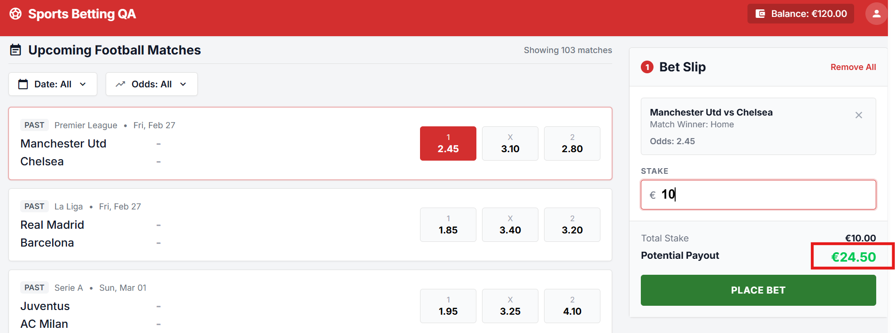
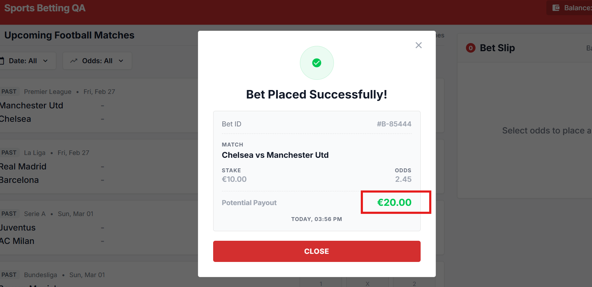
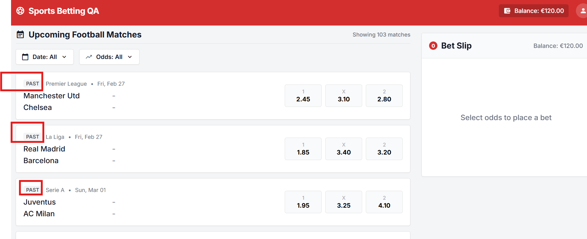
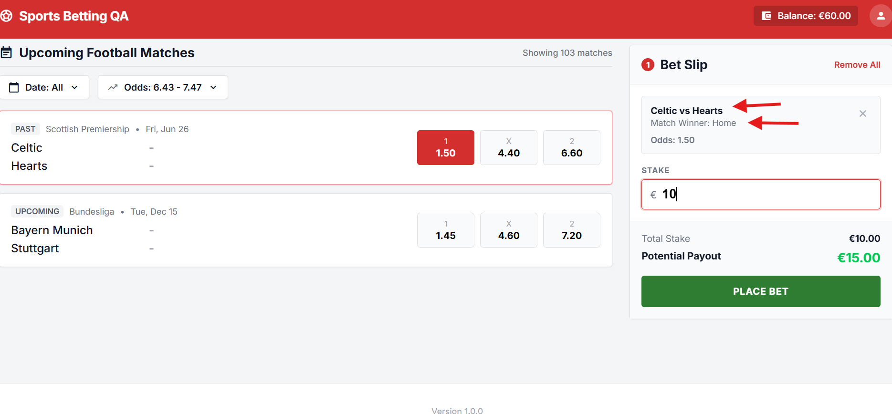
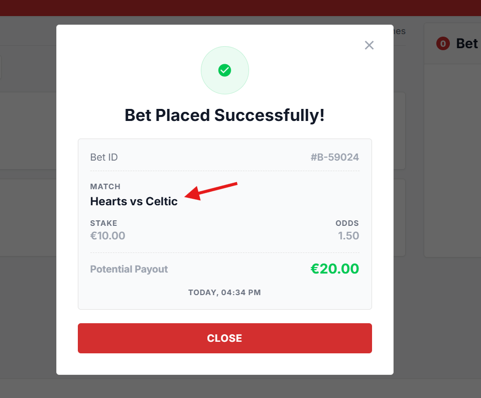
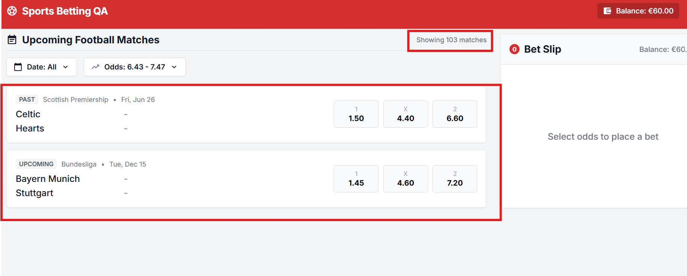
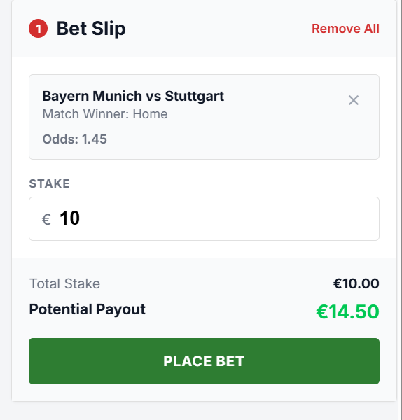

# Bug Reports: Single Bet Placement

**Application:** https://qae-assignment-tau.vercel.app/?user-id=candidate-tynWiuDmY7AR
**Spec:** Feature Specification: Single Bet Placement
**Tested:** Desktop Chromium, UI plus direct API calls
**Evidence note:** Evidence below is the raw API response or observed UI text captured during the exploration.

## BUG-01: API accepts negative stake and credits the balance

**Severity:** Critical

**Reproduction steps**
1. Note the balance: `GET /api/balance` returns `120`.
2. Send `POST /api/place-bet` with `{"matchId":"premier-league-manutd-chelsea","selection":"HOME","stake":-5}` and header `x-user-id`.
3. Call `GET /api/balance` again.

**Expected vs actual**
- **Expected:** 422 `invalid_stake_min` ("Stake must be at least 1.00."), no bet, balance unchanged. `0` and `0.99` are correctly rejected this way.
- **Actual:** 200 "Bet placed successfully". The balance rose from 120 to 125 and the payout was negative.

**Business impact:** Anyone calling the API directly can add money to their account at will, which is a direct financial loss. The UI blocks negative values, but the API is the real control.

**Evidence:** response body `{"message":"Bet placed successfully","matchId":"premier-league-manutd-chelsea","selection":"HOME","stake":-5,"odds":2.45,"payout":-12.25,"balance":125,"currency":"USD"}`.

---

## BUG-02: API does not enforce insufficient balance (balance goes negative)

**Severity:** Critical

**Reproduction steps**
1. Get a balance below €100. For example, place €100 on any match so the balance becomes €20, then keep betting down to about €14.
2. Send `POST /api/place-bet` with a stake larger than the balance (for example, `13.67` when the balance is `13.66`).
3. Call `GET /api/balance`.

**Expected vs actual**
- **Expected:** Reject the bet as insufficient balance (spec 4.1: "Must not exceed available balance", UI and API). The balance is unchanged.
- **Actual:** 200 OK. The balance became `-0.01`, and can further go negative with more bets. The UI blocks this correctly ("Insufficient balance" appears and `Place Bet` is disabled), so the check exists only on the client.

**Business impact:** Users can bet money they don't have, and the operator carries unrecoverable exposure.

**Evidence:** response `{"message":"Bet placed successfully","stake":13.67,"odds":2.45,"payout":33.49,"balance":-0.01,"currency":"USD"}`, and `GET /api/balance` returned `{"balance":-0.01,"currency":"EUR"}`.

---

## BUG-03: Success receipt shows wrong Potential Payout

**Severity:** Critical

**Reproduction steps**
1. In the UI, click the `X` (draw) odds of Inter vs Napoli (odds 3.35).
2. Enter stake `10`. The bet slip shows Potential Payout €33.50.
3. Click `Place Bet` and read the receipt.

**Expected vs actual**
- **Expected:** The receipt shows the payout from the slip and the API (stake × odds = €33.50, spec 2.4).
- **Actual:** The receipt shows `€20.00`. The same happened on other bets: stake 1 at 2.05 showed €2.00 (expected 2.05), and stake 5 at 3.35 showed €10.00 (expected 16.75). In every case the receipt payout equals stake × 2 and ignores the odds. The API (`/api/place-bet`) returns the correct payout (for example, `stake 100 at 2.45 → 245`), so the defect is in the UI receipt.

**Business impact:** Customers see a lower payout than they were quoted, which leads to disputes and complaints and can be a legal problem, since the receipt is the record of the bet.

**Evidence:** slip text `Potential Payout €33.50` vs receipt text `Potential Payout €20.00` for the same bet

Refer:
Bet slip: 
Succes Receipt: 
---

## BUG-04: Past matches are listed as upcoming and accept bets

**Severity:** Critical

**Reproduction steps**
1. Open the app and scroll the "Upcoming Football Matches" list. The first matches (for example, Manchester Utd vs Chelsea, Fri Feb 27) carry a `PAST` label. The app date is today date.
2. Click an odds button on a `PAST` match, enter stake `10`, and click `Place Bet`.
3. Alternatively, send `POST /api/place-bet` with `matchId` `premier-league-manutd-chelsea`.

**Expected vs actual**
- **Expected:** Only upcoming matches are listed and bettable (spec section 1 and 3: "Upcoming matches only"). The API should reject bets on past events.
- **Actual:** `PAST` matches are shown in the upcoming list, their odds are selectable, and bets on them succeed in both the UI and the API (for example, €100 on Feb 27 Manchester Utd vs Chelsea returned 200).

**Business impact:** Bets can be placed on events whose results are already known, which exposes the operator to guaranteed-win bets.

**Evidence:** list text `PAST Premier League • Fri, Feb 27 Manchester Utd - Chelsea`, and a 200 response for the past match ID.

Refer screenshot: 

---

## BUG-05: Success Receipt shows swapped teams and no Selection

**Severity:** Critical

**Reproduction steps**
1. Select a match Inter vs Napoli (home team Inter, away team Napoli) and place a valid bet.
2. Read the receipt.

**Expected vs actual**
- **Expected:** The receipt shows the match as `Inter vs Napoli` and includes the Selection (spec 2.4 lists Bet ID, Match details, Selection, Stake, Odds, Potential payout, Timestamp).
- **Actual:** The receipt shows `Napoli vs Inter` (home and away swapped, while the bet slip shows `Inter vs Napoli`). There is no Selection field at all (only Bet ID, Match, Stake, Odds, Potential Payout, time).

**Business impact:** The bet record is incorrect and incomplete. A user cannot confirm what they bet on, and a "Home" bet looks like an "Away" one on the receipt.

**Evidence:** Success receipt text `Napoli vs Inter`, versus the bet slip `Inter vs Napoli`.

Refer Screenshot:
Bet Slip: 
Success receipt: 

---

## BUG-06: Balance in UI is not updated after a successful bet

**Severity:** High

**Reproduction steps**
1. Load the app. The header shows `Balance: €120.00`.
2. Place a valid €10 bet on an upcoming match and close the receipt.
3. Compare the header and bet slip balance with `GET /api/balance`.
4. Reload the page.

**Expected vs actual**
- **Expected:** The stake is deducted and the balance is updated at once (spec 2.3, "stake is deducted").
- **Actual:** The header and slip still show `€120.00` while the API returns `110`. The correct value appears only after a page reload. This repeated for every bet (the Rebet case showed `€103.00` in the UI against `98` in the API).

**Business impact:** Users see an incorrect balance and may try to bet money they have already spent (the server then accepts it because of BUG-02) or lose trust in the displayed funds.

**Evidence:** UI balance `Balance: €120.00` vs API `{"balance":110,"currency":"EUR"}` right after success receip`; after reload the UI showed `€110.00`.

---

## BUG-07: Place Bet is not blocked while `Placing...`, so a multi-click creates duplicate bets

**Severity:** High

**Reproduction steps**
1. Select Inter vs Napoli "1" and enter stake `1`. Balance is `110`.
2. Click `Place Bet` three times quickly.
3. Watch the network requests and the balance.

**Expected vs actual**
- **Expected:** After the first click the button is in a loading state and disabled (spec 2.3). Exactly one request is sent, and one bet is placed.
- **Actual:** The button shows `PLACING...` but is not disabled (`disabled: false`). Three `POST /api/place-bet` requests were sent. One returned 409 and two succeeded, so the balance dropped from 110 to 108 and two receipts appeared (the second one reopened after the first was closed).

**Business impact:** Customers who double-click are charged twice for a bet they meant to place once.

**Evidence:** 3 POST requests recorded, one console `409` error, balance 110 → 108

---

## BUG-08: Reset balance response differs from the persisted balance

**Severity:** Medium

**Reproduction steps**
1. Send `POST /api/reset-balance` with header `x-user-id`.
2. Send `GET /api/balance`.

**Expected vs actual**
- **Expected:** Both return the same balance (spec 5.3: "Response body and persisted state must be consistent after reset").
- **Actual:** Reset returns `125.5`, but `GET /api/balance` returns `120`. Reproduced on every call.

**Business impact:** The API reports an amount the user doesn't have, and test environments cannot be reset to a known state reliably.

**Evidence:** `{"message":"Balance reset successfully","balance":125.5,"currency":"EUR"}` vs `{"balance":120,"currency":"EUR"}`.

---

## BUG-09: Odds filter accepts an invalid range (min > max) without feedback

**Severity:** Medium

**Reproduction steps**
1. Click `Odds: All` to open the filter.
2. Set MIN `5.00` and MAX `2.00`.
3. Click `Apply`.

**Expected vs actual**
- **Expected:** The range is rejected with clear feedback (spec 2.6), and the filter is not applied.
- **Actual:** The popover closes silently and the toggle reads `Odds: 5.00 - 2.00`. No error message is shown.

**Business impact:** Users get a misleading or empty list with no explanation of what went wrong.

**Evidence:** toggle text `Odds: 5.00 - 2.00` after Apply; no error text in the popover.

---

## BUG-10: Odds filter minimum boundary is exclusive

**Severity:** Medium

**Reproduction steps**
1. Open the Odds filter, set MIN `2.00` and MAX `2.10`, and click `Apply`.
2. Compare the list with `GET /api/matches`. Four matches have home odds of exactly 2.00 (Napoli vs Lazio, Monaco vs Rennes, Celtic vs Rangers, Newcastle vs Brighton).

**Expected vs actual**
- **Expected:** Range is inclusive on both ends (spec 2.6), so those four matches appear.
- **Actual:** The four matches with odds equal to 2.00 are missing, while matches with odds equal to the maximum (2.10) are shown. The filter matches any of the three outcomes, and the lower boundary is excluded.

**Business impact:** Valid matches are hidden from users, so some bets can't be found through the filter.

**Evidence:** expected 18 matches, 14 shown. Missing IDs: `serie-a-napoli-lazio`, `ligue-1-monaco-rennes`, `scottish-celtic-rangers`, `premier-league-newcastle-brighton-2026-09-02`.

---

## BUG-11: Place-bet response returns currency `USD` instead of `EUR`

**Severity:** Medium

**Reproduction steps**
1. Send a valid `POST /api/place-bet` (for example, stake `10` on `premier-league-manutd-chelsea`).
2. Read `currency` in the response.

**Expected vs actual**
- **Expected:** `"currency": "EUR"` (spec section 3: currency is EUR).
- **Actual:** `"currency": "USD"` in every successful response, while `GET /api/balance` returns `EUR`.

**Business impact:** The wrong currency in a financial response can cause incorrect amounts in downstream systems and reports.

**Evidence:** `{"message":"Bet placed successfully","stake":10,"odds":2.45,"payout":24.5,"balance":110,"currency":"USD"}`.

---

## BUG-12: Malformed JSON returns 500, and `GET /api/place-bet` returns 200

**Severity:** Medium

**Reproduction steps**
1. Send `POST /api/place-bet` with body `{bad` (header `Content-Type: application/json`).
2. Send `GET /api/place-bet`.

**Expected vs actual**
- **Expected:** Malformed JSON returns 400 `invalid_json` (documented in the OpenAPI). An unsupported method returns 405.
- **Actual:** Malformed JSON returns 500 `internal_server_error`. `GET /api/place-bet` returns 200 with `{}`. (`POST /api/balance` does return 405 correctly.)

**Business impact:** A client error is reported as a server failure, which pollutes error monitoring and hides real incidents.

**Evidence:** `500 {"error":"internal_server_error","message":"Unable to process request."}` and `200 {}`.

---

## BUG-13: "Showing N matches" count and kickoff labels are wrong

**Severity:** Low

**Reproduction steps**
1. Load the app: "Showing 103 matches".
2. Apply a date filter or an odds filter.
3. Compare the count with the cards in the list. In the date filter step, look at the labels of the upcoming matches.

**Expected vs actual**
- **Expected:** The count matches the visible cards, and each match has a consistent kickoff date/time label (spec 2.1).
- **Actual:** The count always stays at `103` (1 card shown for a single day, 14 for the odds filter). Labels are inconsistent, and no kickoff time is shown anywhere (the API gives only `kickoffDate`).

**Business impact:** Users are misled about the number of results and can't see kickoff times, but nothing here affects money.

**Evidence:** `Showing 103 matches` with 1 visible card after the single-day filter; labels `Bundesliga • Saturday` and `Ligue 1 • Wed, Oct 14`.

Refer Screenshot: 

## BUG-14: Available balance is not shown in the bet slip

**Severity:** Low

**Reproduction steps**
1. Load the app
2. Select an odd for any match and enter a stake in Bet slip
3. Check for available balance field in the Bet slip

**Expected vs actual**
- **Expected:** Bet slip should show available balance(spec 2.2).
- **Actual:** Available balance is not shown in Bet slip

**Business impact:** Users might be mislead about the available balance after entering the stake.

**Evidence:** Refer screenshot: 

---

## Notes

- **Out of scope for reports:** minimum stake €1.00 vs €1.01 in the spec. The app accepts €1.00 and rejects €0.99, consistent with the UI copy and the OpenAPI, so the app is not wrong. The spec table should be corrected.
- **Not reproduced:** the 409 "bet already in progress" was returned only in the UI multi-click scenario (BUG-06). Two parallel API requests both returned 200.
